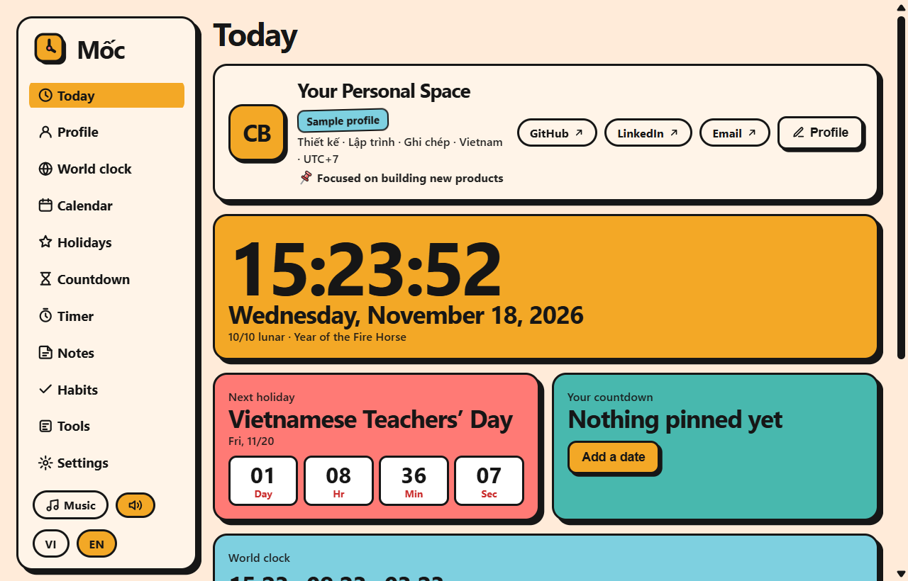
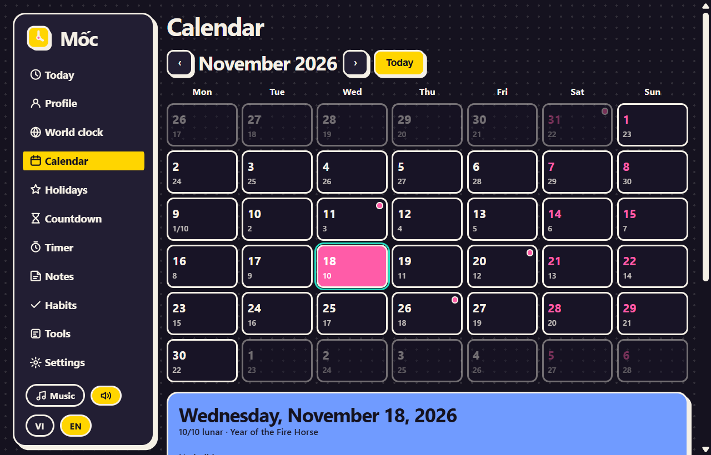
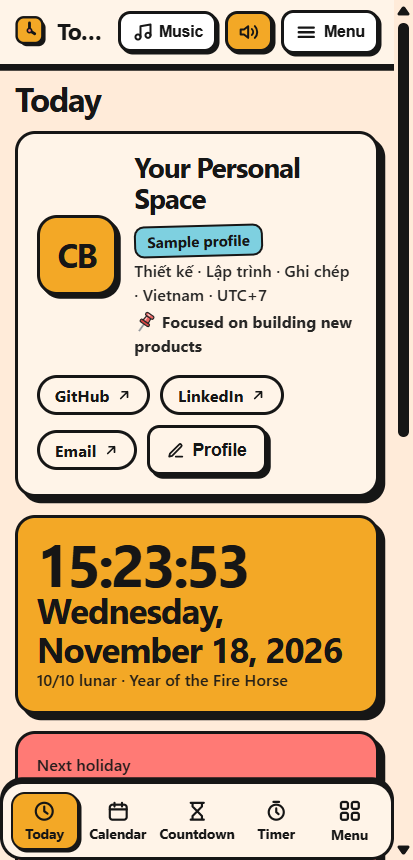
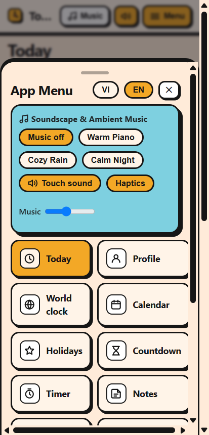

<div align="center">


# Mốc — Time Hub & Personal Space

**An offline-first, neo-brutalist personal time center, Vietnamese lunar calendar, world clock, habit tracker, and portfolio hub for Web, Windows, and Android.**

[](#downloads)
[](https://github.com/hoaipahm/moctime/raw/main/M%E1%BB%91c-Android.apk)
[](https://github.com/hoaipahm/moctime/raw/main/M%E1%BB%91c-Setup.exe)
[](#features)

</div>

---

## Downloads

| Platform | Package | Install Guide |
| :--- | :--- | :--- |
| **Android (7.0+)** | [**Download `Mốc-Android.apk`**](https://github.com/hoaipahm/moctime/raw/main/M%E1%BB%91c-Android.apk) *(~92 KB)* | Transfer or download to your Android phone, tap the `.apk`, and allow installation from this source. |
| **Windows (10/11)** | [**Download `Mốc-Setup.exe`**](https://github.com/hoaipahm/moctime/raw/main/M%E1%BB%91c-Setup.exe) *(~1.4 MB)* | Run the installer (no Admin rights required) to add Desktop & Start Menu shortcuts. |
| **Windows Portable** | [**Download `Mốc.exe`**](https://github.com/hoaipahm/moctime/raw/main/M%E1%BB%91c.exe) *(~1.4 MB)* | Single standalone executable — double-click to launch immediately. |
| **Web / PWA** | [`index.html`](index.html) | Open locally in any browser or deploy directly to Netlify / Vercel. |

---

## Screenshots

### Desktop Experience (12 Themes · Light & Dark)

| Coral Cream — Today Dashboard | Neon Night — Solar & Lunar Calendar |
| :---: | :---: |
|  |  |

### Mobile App Experience (Android & Responsive Web)

| Mobile Today & Bottom Navigation | Slide-Up App Menu & Ambient Soundscape |
| :---: | :---: |
|  |  |

---

## Features

- **Today & Personal Profile Hub:** Live digital clock with tabular numerals, solar & Vietnamese lunar date, next upcoming holiday countdown, pinned personal countdowns, world clock strip, daily cultural proverbs, and an editable personal bio/project showcase (`Export index.html` for 1-click static deployment).
- **Vietnamese Lunar Calendar (Hồ Ngọc Đức Algorithm):** Accurate solar ↔ lunar conversion, leap-month detection, Heavenly Stems & Earthly Branches (*Can Chi*), and custom event pinning.
- **Global Holidays (110+ Countries):** Built-in offline calendars for Vietnam, US, UK, France, Germany, Japan, South Korea, China, Australia, Canada, Singapore, and more — plus live search and 2-year offline caching via Nager.Date when online.
- **World Clock (400+ Offline Zones + Global Lookup):** Instant search across 400+ IANA time zones offline, plus automatic worldwide city/town lookup when connected.
- **Focus Timer, Countdowns & Stopwatch:** Live countdown in the window/tab title, custom `.mp3` alert sound support, and native Windows/Android notifications.
- **Ambient Soundscape & Tactile Audio:** Built-in WebAudio synthesizer with 3 offline relaxing modes (*Warm Piano*, *Cozy Rain*, *Calm Night*), subtle wooden/kalimba touch feedback sounds, and gentle Android haptics.
- **Notes, Habits & Date Utilities:** Pinned sticky notes with instant filter, 7-day habit streak tracker, date difference/offset calculator, age & zodiac inspector, meeting time-zone planner, coin flip, and dice roller.
- **12 High-Contrast Themes:** WCAG AA verified palettes (*Coral Cream*, *Polka Yellow*, *Comic Pink*, *Mint*, *Sky Blue*, *Lavender*, *Burnt Orange*, *Matcha*, *Sakura Peach*, *Mono Paper*, *Neon Night*, *Terminal*).
- **Zero-Backend Privacy & Backup:** All user data stays local; export/import full backups via `.json` anytime.

---

## Project Structure

```text
.
├── index.html                 # Single-file web app & PWA core
├── icon.svg                   # Vector app icon
├── manifest.webmanifest       # PWA manifest
├── sw.js                      # Offline Service Worker
├── netlify.toml / vercel.json # Static hosting configs
├── Mốc-Android.apk            # Signed Android APK (ready to install)
├── Mốc-Setup.exe              # Windows Desktop installer
├── Mốc.exe                    # Windows Desktop portable executable
├── android/                   # Native Android WebView wrapper (Java + Adaptive Icons)
├── desktop/MocApp/            # Native Windows WebView2 wrapper (.NET 8 WinForms)
└── docs/images/               # Desktop & mobile screenshots
```

---

## Building from Source

### Android APK
Requires **JDK 17+** and **Android SDK Build-Tools 34 / Platform 34**:
- Java entrypoint: [`android/src/vn/moc/timehub/MainActivity.java`](android/src/vn/moc/timehub/MainActivity.java)
- Manifest & resources: [`android/AndroidManifest.xml`](android/AndroidManifest.xml), [`android/res/`](android/res)

### Windows `.exe`
Requires **.NET 8 SDK** on Windows:
```powershell
dotnet publish desktop\MocApp\MocApp.csproj -c Release -o desktop\publish
```
