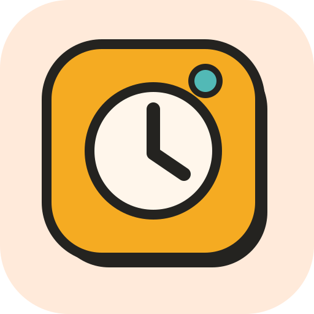
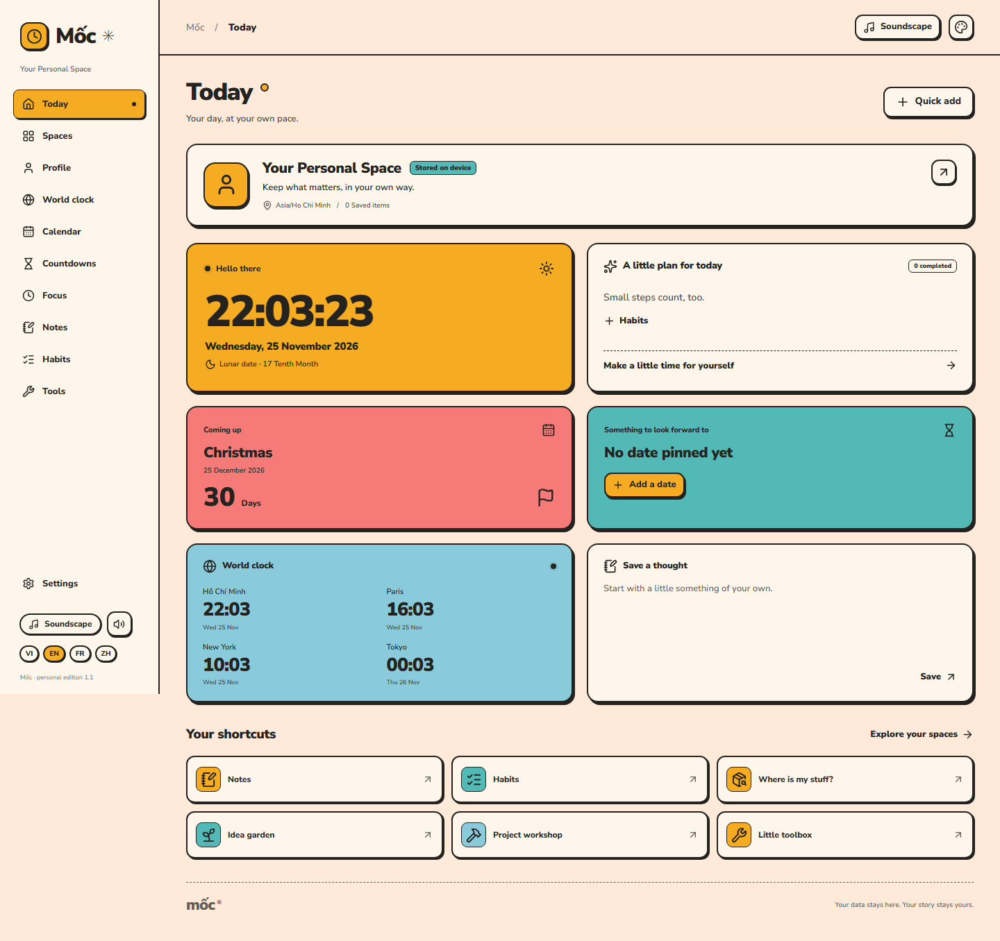
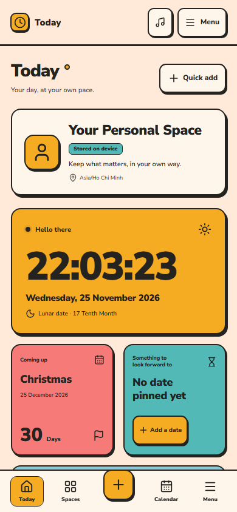
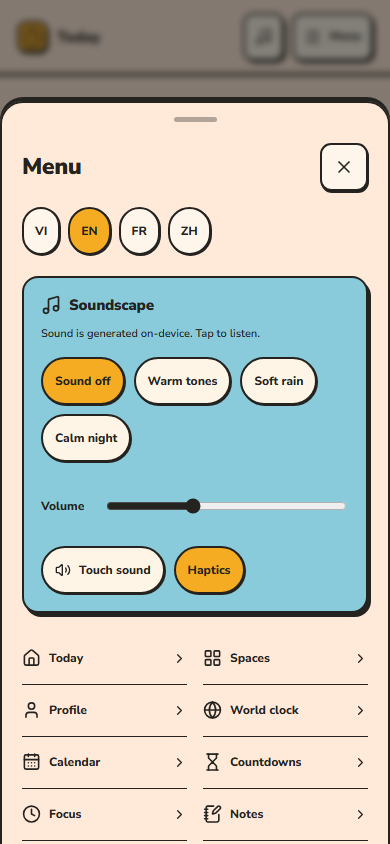
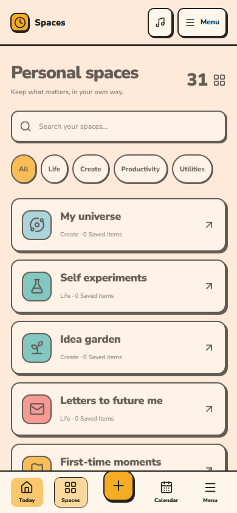
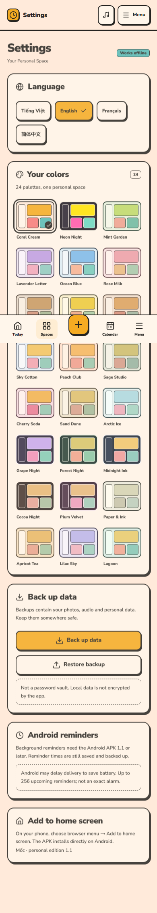
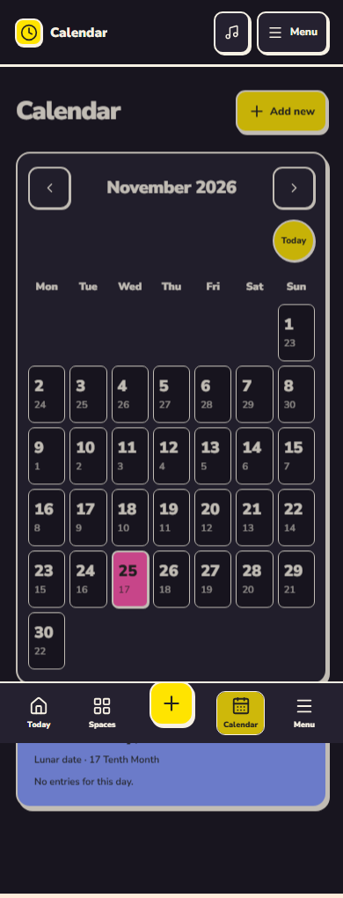

<div align="center">



# Mốc Personal

**Your day, at your own pace.**

An offline personal workspace for Android and the web, with **31 spaces**, **24 color themes**, and **Vietnamese, English, French, and Simplified Chinese**.

[Download Android APK](https://github.com/hoaipahm/moctime/releases/download/personal-v1.1.0/Moc-Personal-1.1.0.apk) · [Release notes](https://github.com/hoaipahm/moctime/releases/tag/personal-v1.1.0) · [Source code](personal/) · [App review](personal/docs/REVIEW.md)

</div>



## Download and install

| Package | Download | Requirements |
| --- | --- | --- |
| **Mốc Personal 1.1.0 — preview APK** | [GitHub Release](https://github.com/hoaipahm/moctime/releases/download/personal-v1.1.0/Moc-Personal-1.1.0.apk) · [Repository mirror](https://github.com/hoaipahm/moctime/raw/refs/heads/main/downloads/Moc-Personal-1.1.0.apk) | Android 8.0+ with an updated Android System WebView |
| Checksums | [SHA256SUMS.txt](downloads/SHA256SUMS.txt) | Compare before installing |

Download the APK on your Android phone, open it, allow installation from that source if prompted, and select **Install**. Open **Menu → Settings** to choose a language or theme. No account or running computer is required after installation.

This is a development-signed preview, not a Google Play release. Installing future Personal APKs signed with the same key should retain app data. **Back up before uninstalling or clearing storage.**

The older **Mốc Time Hub** app and Windows packages remain in this repository. Personal uses the separate Android package `vn.moc.personal`; it does **not** overwrite or automatically migrate data from the older `vn.moc.timehub` app. See the [original Time Hub README](README-TimeHub.md) for those packages.

## On your phone

<table>
<tr><th>Today</th><th>App menu and soundscape</th><th>Personal spaces</th></tr>
<tr>
<td></td>
<td></td>
<td></td>
</tr>
</table>

These are actual browser captures of the application, not design mockups. They demonstrate responsive layouts; they do not establish physical Android device behavior.

## Features

- **A personal Today dashboard:** live clock, lunar date, four world clocks, selected special days, countdowns, quick notes, habits, and pinned shortcuts.
- **31 searchable spaces:** organize everyday life, projects, ideas, memories, and practical tools in one place.
- **24 complete palettes:** switch between warm paper colors and six night variants. Your choice survives a restart.
- **Four shared languages:** navigation, forms, validation, dates, number formatting, and report labels use one persisted locale.
- **Your own media:** attach photos or record up to two minutes of audio. Records, media, settings, and schedules stay on-device.
- **Android reminders:** choose a local reminder time for a dated record, then enable notifications in Settings. Native alarms are re-registered after reboot, app updates, and device time changes. Delivery is inexact and may be delayed by battery policies.
- **Persistent free-time planning:** save busy periods by day, merge overlapping intervals, and find gaps between 08:00 and 22:00.
- **Backup and restore:** export a complete JSON backup. Imports are validated before replacing data in a single IndexedDB transaction.
- **Offline use:** APK assets are bundled. The web production build is cached after its first successful load on HTTPS or localhost.

<details>
<summary><strong>Explore all 31 spaces</strong></summary>

| Life | Creativity | Productivity | Utilities |
| --- | --- | --- | --- |
| Self experiments | My universe | Project workshop | Little toolbox |
| Letters to future me | Idea garden | Screenshot checklist | File organizer |
| First-time moments | Thought map | Project launch book | Document comparison |
| Everyday quests | My personal museum | Personal reports | Find free time |
| Where is my stuff? | Design shelf | Project demos | |
| Where to today? | Speak & save | Actionable links | |
| What to wear? | Sound postcards | Notes | |
| Pocket deadlines | | | |
| What’s in the fridge? | | | |
| A date with myself | | | |
| Habits | | | |
| Countdowns | | | |
| Money journal | | | |

Spaces offer specific fields and workflows: inventory locations, project progress and next steps, manually entered screenshot checklists, and sequential project demos.

</details>

<details>
<summary><strong>See all themes and the night calendar</strong></summary>




</details>

## Honest boundaries

- No connected AI, OCR, speech-to-text, online place search, or automatic recipe generation.
- Project launch profiles save instructions without executing computer commands. File organization reads selected files and exports groups/hashes without moving or deleting originals.
- Text comparison handles pasted lines, not DOCX/PDF parsing or semantic review.
- Future letters hide content in the interface until a chosen day; this is not encryption or a secure time lock.
- Local data is not encrypted by the app. Do not use it as a password vault. Backups contain personal text, photos, and audio.
- Android reminders are opt-in and inexact. Force-stopping, revoking permissions, or battery restrictions may prevent delivery. The focus timer is not a background alarm.
- Lunar dates use the platform’s Chinese calendar in the Vietnam time zone, not an independently validated Vietnamese astronomical calendar.
- Browser and APK storage are separate. Use backup/restore to transfer Personal data. Physical Android camera, microphone, reminder delivery, and OEM behavior still require device testing.

## Run from source

Use Node.js **24.14.1 or a compatible newer Node 24 release** and npm:

```sh
git clone https://github.com/hoaipahm/moctime.git
cd moctime/personal
npm ci
npm run dev -- --port 4317
```

Open `http://localhost:4317`. For a production build:

```sh
npm run build
npm run preview -- --port 4318
```

The repository root still contains the original static Time Hub app. The new Personal application is in **[`personal/`](personal/)**; serving the old root `index.html` does not run the new Vite application.

## Checks and review

```sh
cd personal
npm test
npm run format:check
npm run build
# With the dev server running at port 4317:
npm run test:browser
```

Windows native build and JVM time tests require Java 17 and Android SDK Platform 35 / Build Tools 35.0.0:

```powershell
$env:JAVA_HOME = 'C:\path\to\jdk-17'
.\scripts\test-native.ps1
.\scripts\build-android.ps1 -SdkRoot 'C:\path\to\Android\Sdk'
```

Read the [app review and verification limits](personal/docs/REVIEW.md), [developer guide](personal/README.md), and [release notes](personal/docs/RELEASE-1.1.0.md). A successful build or APK signature check does not establish real-phone operation.

## Repository layout

```text
personal/                 New React + TypeScript application
  src/                    UI, localization, themes, domain and persistence
  android/                Offline Android shell and reminder receiver
  public/                 App icon and PWA manifest
  tests/                  Domain, browser and JVM time tests
  scripts/                Build and verification helpers
downloads/                Personal APK and SHA-256 checksum
docs/screenshots/         Current Personal application captures
android/, desktop/        Original Time Hub implementation, preserved
README-TimeHub.md         Original app documentation
```
